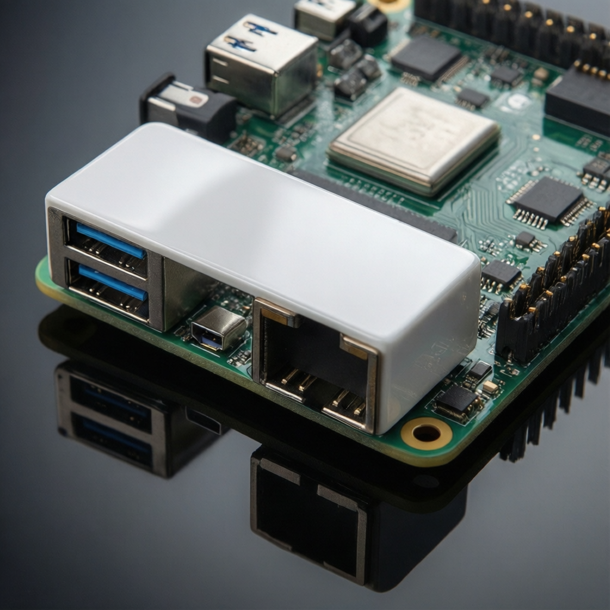

# operator-alem-image-plus

Image generation skill for Operator using Alem AI Plus text-to-image.

## Install

```bash
operator install https://github.com/yrn-dev/operator-alem-image-plus
```

## What it includes

- `alem-image-plus` skill
- first-run API key setup flow
- prompt builder for short or messy user requests
- generation script for the Alem image endpoint
- Qwen-Image-2512 prompting guide

## Sample outputs

### Portrait


### Product shot



### Atmospheric scene


### Lifestyle scene


## Notes

- Users must provide their own Alem AI Plus API key
- The skill is for text-to-image generation, not exact face-lock or identity-preserving editing
